# Microsoft Defender Antivirus checks (Windows 11)

Cases 8 and 9 of my troubleshooting log. Cases 1 to 7 are server and cloud faults in my [AWS Operations Lab](https://github.com/Yuka-30v/aws-ops-lab). These two were done on a local Windows 11 laptop to practise the endpoint security checks a first-line service desk carries out.

**Environment:** Windows 11, Microsoft Defender Antivirus (product version 4.18.26090.9), Windows PowerShell, Event Viewer (Applications and Services Logs > Microsoft > Windows > Windows Defender > Operational)

**Test file:** EICAR, the industry-standard harmless test file used to check that antivirus software is working. No real malware was used.

**Date:** 20 October 2026

---

## Case 8: Antivirus detection showed no results, then a contradictory result

**Symptom**
After creating the EICAR test file, `Get-MpThreatDetection` returned nothing. Later, `Test-Path` reported that the file existed, but `Get-Content` immediately afterwards reported that it did not.

**Checks**

1. Confirmed Defender was running: `Get-MpComputerStatus` showed AMServiceEnabled, AntivirusEnabled and RealTimeProtectionEnabled all True, with signatures updated that day.

   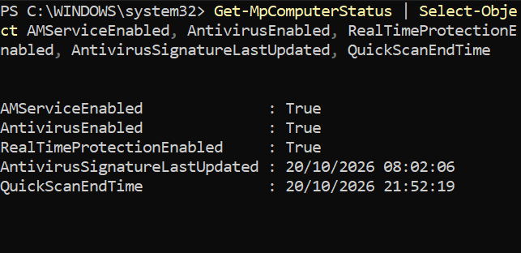
2. Noticed the prompt was `C:\Users\yukag`, meaning PowerShell was **not** running as Administrator.
   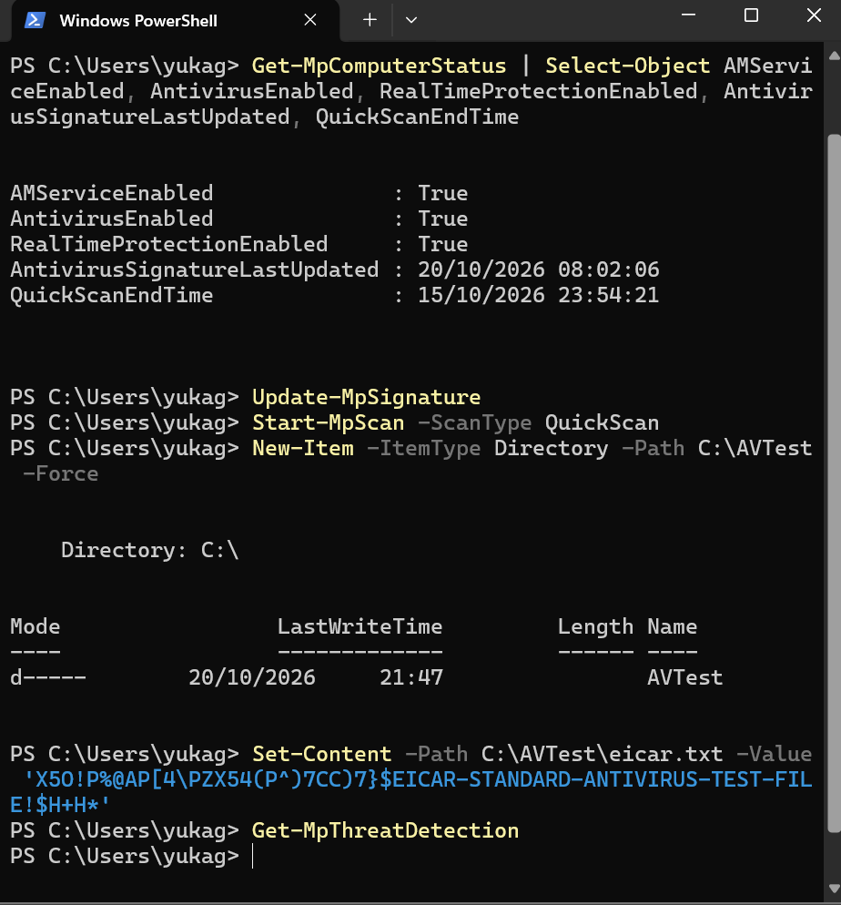
3. Reopened PowerShell as Administrator and re-ran `Get-MpThreatDetection`. Real-time protection (DetectionSourceTypeID 3) had detected `C:\AVTest\eicar.txt`, written by `powershell.exe`, at 21:47:00 and remediated it at 21:47:38 (ThreatStatusID 3, ActionSuccess True).
   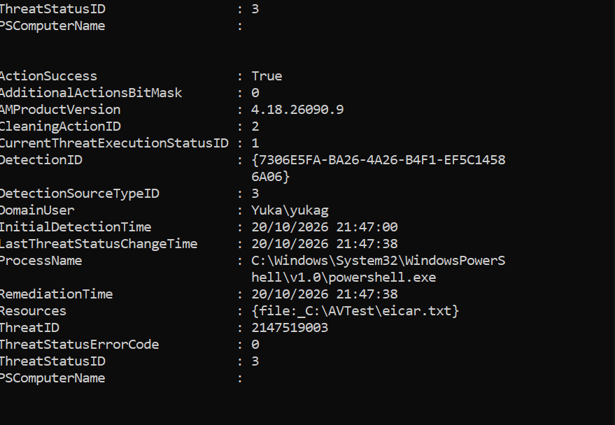
4. Created the test file a third time. The new detection record (21:53:33) showed ThreatStatusID 1 and an **empty RemediationTime**: detected, but not yet removed.
   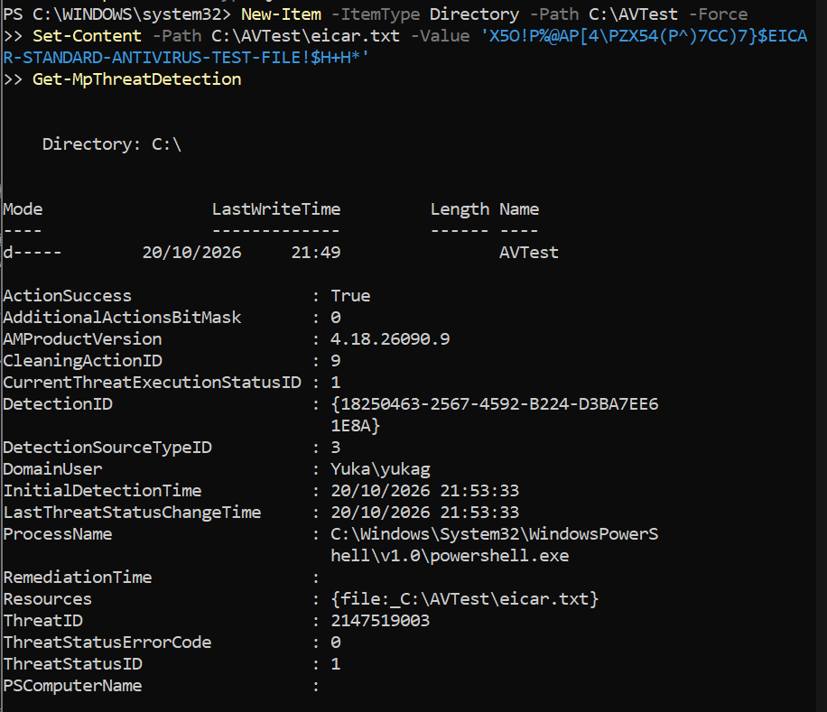
5. That explained the contradiction: `Test-Path` ran while the file still existed, and Defender removed it seconds before `Get-Content` ran. A final `Test-Path` returned False and the folder was empty.
   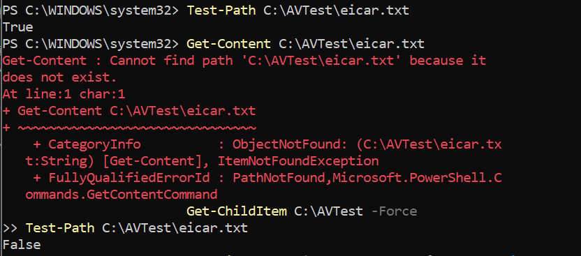
6. Confirmed in Event Viewer: 1116 (detected) and 1117 (action taken) for `Virus:DOS/EICAR_Test_File`, with the action run by SYSTEM (the Defender service), not by my user account.
   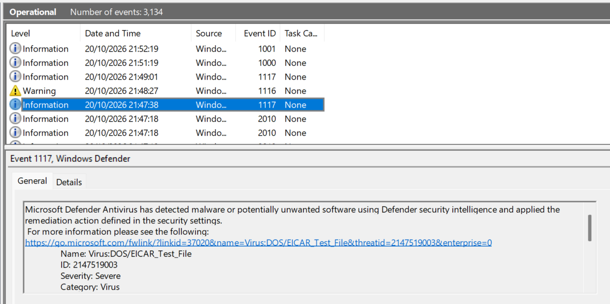

**Timeline from the event log**

| Time | Event | Meaning |
|---|---|---|
| 21:47:00 to 21:47:38 | detection record, 1117 | 1st test file detected and remediated |
| 21:48:27 to 21:49:01 | 1116, 1117 | 2nd test file detected and remediated |
| 21:51:19 to 21:52:19 | 1000, 1001 | Quick scan started and finished |
| 21:53:33 to 21:54:08 | 1116, 1117 | 3rd test file detected, then remediated about 35 seconds later |

**Root cause**

1. `Get-MpThreatDetection` returned an empty result, with no error, when run without administrator rights.
2. Detection and remediation are not instant. `Test-Path` ran in the gap between them.

**Lesson**
An empty or contradictory result is not the final answer. Check permissions, check timing, and confirm through a second source (the event log).

---

## Case 9: Disabling real-time protection: blocked from PowerShell, allowed from Windows Security

**Action 1:** Tried to turn off real-time protection from an elevated PowerShell session (`Set-MpPreference -DisableRealtimeMonitoring $true`) at 22:14.

**Result 1: blocked**

- `RealTimeProtectionEnabled` stayed True, and no 5001 (protection disabled) event appeared.
- Two 5013 events at 22:14:00: *"Tamper Protection blocked a change to Microsoft Defender Antivirus"*, value `Real-Time Protection\DisableRealtimeMonitoring`.

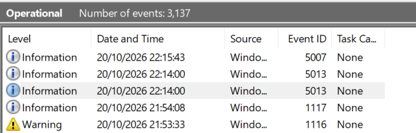
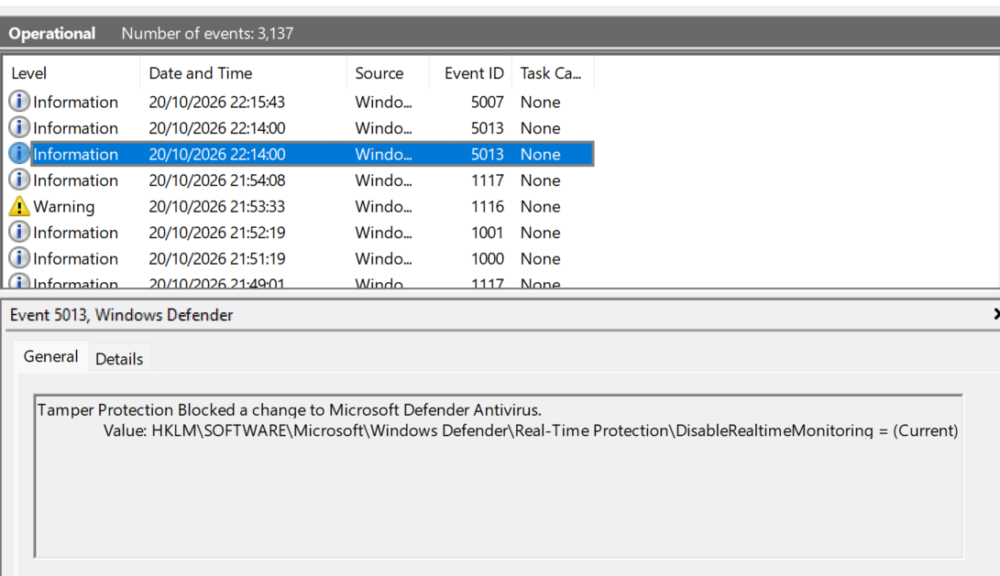

**Ruled out:** a 5007 (configuration changed) event at 22:15:43. Despite its warning text (*"may be the result of malware"*), it changed an internal Microsoft configuration value (`Features\EcsConfigs\ETag\Tag`), was made by SYSTEM, was not a protection setting and did not match the time of my test. No escalation needed.

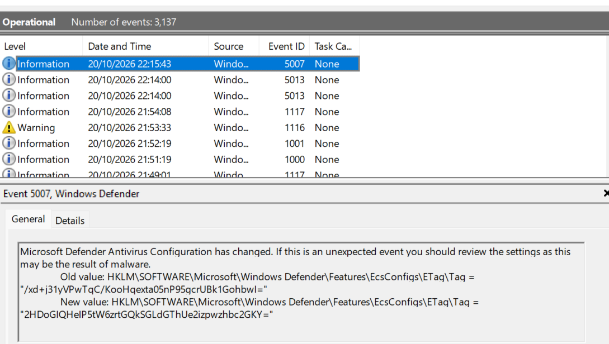

**Action 2:** Turned off real-time protection in the Windows Security app (Virus & threat protection > Manage settings) at 22:31.

**Result 2: allowed**

- `RealTimeProtectionEnabled` = False, and a 5001 event was logged at 22:31:50.

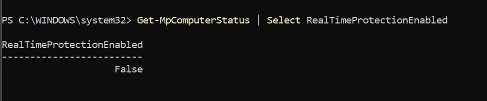
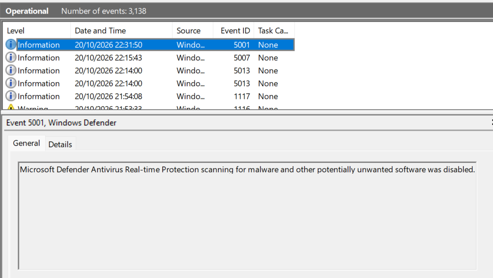

**Fix**
Turned real-time protection back on in Windows Security at 22:34 (5000 event, about 2 minutes after the 5001 event). Confirmed `RealTimeProtectionEnabled` = True and `IsTamperProtected` = True. A further 5013 event was logged in the same second as the 5000 event, and 1150 / 1151 (routine health reports) at 22:39:52; neither indicated a problem.

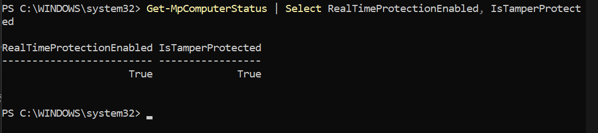
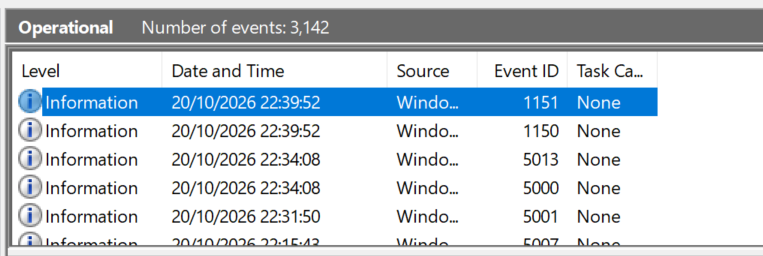

**Root cause**
Tamper Protection blocks changes to key Defender settings made by scripts and other programs, but allows a change the user makes in the Windows Security app.

**Lesson**
When a setting does not change, check the event log for what blocked it before trying again. Never turn off Tamper Protection just to make a change work. Judge an event by what changed, who changed it and when, not by the wording of its message.

---

### Event IDs used

| ID | Meaning |
|---|---|
| 1000 / 1001 | Scan started / finished |
| 1116 | Malware detected |
| 1117 | Action taken against malware |
| 5000 | Real-time protection enabled |
| 5001 | Real-time protection disabled |
| 5007 | Defender configuration changed |
| 5013 | Tamper Protection blocked a change |
